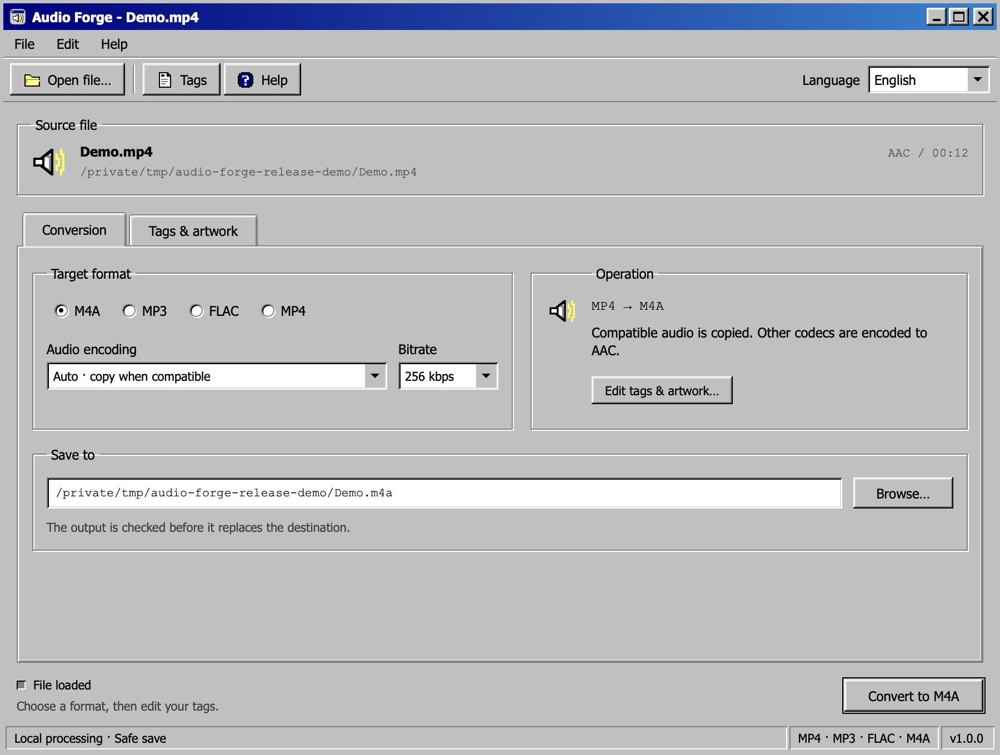
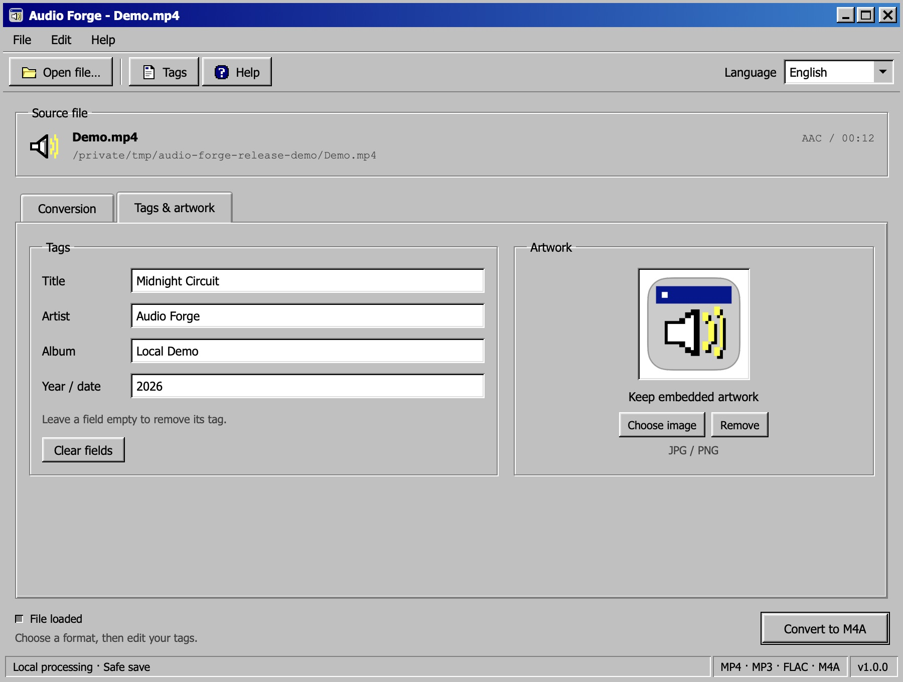

# Audio Forge

**A small, local music converter with a Windows 98 soul.**

[](LICENSE)
[](https://github.com/tsuikaii/Audio_Forge/releases/latest)
[](https://github.com/tsuikaii/Audio_Forge/actions/workflows/test.yml)

Convert MP4, MP3, FLAC, and M4A, edit the essential tags, and give your music
the right cover. Classic gray panels, blue title bars, beveled buttons, pixel
icons, and property tabs bring the feel of an old desktop utility to a native
macOS window. Your files stay on your computer.



## Features

- **Four formats, every direction:** MP4 ↔ MP3 ↔ FLAC ↔ M4A.
- **Essential metadata:** title, artist, album, and year/date.
- **Cover artwork:** add, replace, restore, or remove JPEG/PNG covers.
- **No needless re-encoding:** compatible audio can be copied; matching formats edit tags in place.
- **Safe saves:** validate a temporary output before replacing a destination; confirm overwrites.
- **A real desktop client:** Dock icon, keyboard shortcuts, draggable title bar, and internal window controls.
- **Three interface languages:** English by default, Simplified Chinese, and Japanese.
- **Self-contained install:** bundled Python and audio-focused FFmpeg; no Homebrew or pip required to use it.

## Download and install

Download [Audio Forge v1.0.0 for Apple Silicon](https://github.com/tsuikaii/Audio_Forge/releases/download/v1.0.0/Audio-Forge-1.0.0-arm64.dmg)
or visit [Releases](https://github.com/tsuikaii/Audio_Forge/releases/latest).
Requires **macOS 15 or later** on an **Apple Silicon Mac**. There is currently
no packaged Windows, Linux, or Intel Mac client; Windows 98 describes the visual style.

1. Open the DMG and drag **Audio Forge.app** into **Applications**.
2. Eject the disk image and open Audio Forge from Applications or Launchpad.
3. Choose **Open file…**, select an output format, and click **Start conversion**.

The release is ad-hoc signed, **not Apple-notarized**. If macOS blocks the first
launch, attempt to open the app, then use **System Settings → Privacy & Security
→ Open Anyway** for this application. Do this only for a download you trust;
there is no need to disable Gatekeeper. See [Apple's instructions](https://support.apple.com/en-us/102445).

Checksums are provided in
[`SHA256SUMS.txt`](https://github.com/tsuikaii/Audio_Forge/releases/download/v1.0.0/SHA256SUMS.txt).
To verify a downloaded installer, run `shasum -a 256 Audio-Forge-1.0.0-arm64.dmg`
and compare the result with the matching entry.

This application uses **FFmpeg under LGPL-2.1-or-later** and **LAME under
LGPL-2.0-or-later**. Their exact sources and build recipe are available in the
[third-party source download](https://github.com/tsuikaii/Audio_Forge/releases/download/v1.0.0/Audio-Forge-1.0.0-third-party-sources.tar.gz).
See [third-party notices](THIRD_PARTY_NOTICES.md) for all bundled components.

## Use it

1. Open an MP4, MP3, FLAC, or M4A file.
2. Choose the target format in **Conversion**. **Auto** copies compatible audio
   or picks the format's default encoder.
3. Open **Tags & artwork** to edit metadata and cover art. Clear a field to
   remove that tag. Unsaved changes stay in place when switching tabs.
4. Check the output location, then convert or save tags.
5. Use **Show in Finder** to locate the result.



Matching input and output formats save tags without re-encoding and default to
the original file. Choose another destination to save a separate copy. Other
formats create a new file next to the source. Quit is blocked during conversion
to protect the active save.

| Action | Shortcut |
| --- | --- |
| Open a file | Cmd+O / Ctrl+O |
| Convert or save tags | Cmd+Enter / Ctrl+Enter |
| Switch focused property tabs | Left / Right arrow |
| Quit the macOS client | Cmd+Q |

Drag the blue title bar to move the window. Double-click it, or use the middle
caption button, to maximize/restore. The left button minimizes to the Dock;
the right button closes the client and its local service.

## Formats and limits

| Output | Auto audio behavior | Video behavior |
| --- | --- | --- |
| M4A | Copy AAC/ALAC; otherwise encode AAC | Audio plus compatible cover |
| MP3 | Copy MP3; otherwise encode MP3 | Audio plus compatible cover |
| FLAC | Copy FLAC; otherwise encode FLAC | Audio plus compatible cover |
| MP4 | Copy AAC/ALAC/MP3; otherwise encode AAC | Preserve existing video; audio inputs produce audio-only MP4 |

AAC and MP3 encoding default to 256 kbps. ALAC is available for M4A/MP4.
The first audio track is used. Conversion to FLAC or ALAC cannot restore detail
already lost in a recording. Unexposed tags are preserved where the target
format supports them; private player tags may not survive container rebuilding.
An extension alone does not guarantee its contents use a supported codec.

The tool processes one file at a time. It does not download music, synchronize
a library, batch-convert folders, or re-encode video. The macOS client uses
system WebKit rather than bundling a browser. Its authenticated backend listens
only on `127.0.0.1`; the UI loads no remote resources and uploads no files.

## Run or build from source

Development requires Python 3.12+ and FFmpeg/ffprobe. **There are no pip or npm
dependencies.**

```sh
git clone https://github.com/tsuikaii/Audio_Forge.git
cd Audio_Forge
python3 -B m4a_gui.py
```

For native builds, dependency configuration, tests, and project layout, see
[Building and development](docs/BUILDING.md). The package builder uses a pinned
shared LGPL media build and omits unused Python extensions to keep the release
small. Editable sources and license notices are included in the app.

An optional CLI is retained for scripts:

```sh
python3 mp4_to_m4a.py convert "video.mp4" -o "song.mp3" --title "Song" --artist "Artist"
python3 mp4_to_m4a.py edit "song.m4a" --title "New title" --cover "cover.png"
python3 mp4_to_m4a.py show "song.flac"
```

Use `convert --help` or `edit --help` for options. The CLI retains extra metadata
fields for compatibility; the GUI deliberately focuses on four essential tags.

## Contributing and license

Bug reports and focused improvements are welcome. See
[Contributing](CONTRIBUTING.md), [Security](SECURITY.md), and the
[Changelog](CHANGELOG.md).

Audio Forge's original source, documentation, and pixel artwork are licensed
under the **[MIT License](LICENSE)**. Bundled dependencies retain their respective
licenses. Audio Forge is an independent project, with no affiliation with
Apple, Microsoft, or FFmpeg.
